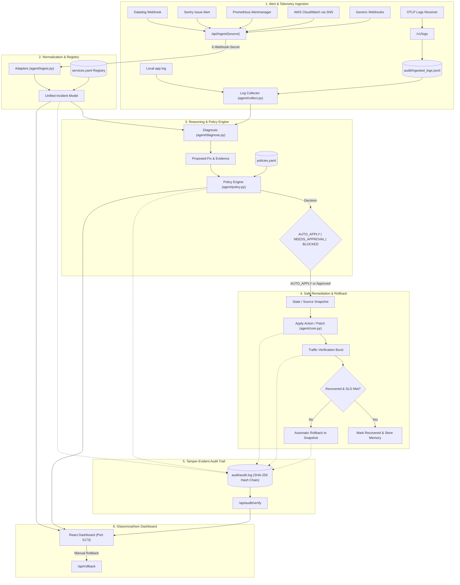

# OnCall AI: autonomous on-call engineer

Breaks a real service, finds the root cause from logs, asks for approval, applies a fix, and proves recovery with numbers. Remembers failed fixes so it never repeats them.

## Supported Faults & Remediation

| Fault | Symptom | Right Fix | Plausible Wrong Fix | Description |
|---|---|---|---|---|
| `pool_exhaustion` | 503 errors (`QueuePool limit reached`), high p95 | `rollback_config` | `scale_pool` | DB connections held too long (2s) |
| `slow_query` | Elevated p95 latency (0.8-1.5s), 0 errors | `add_index` | `restart_service`, `scale_pool` | Missing database index causes table scan |
| `bad_deploy` | ~40% 500 errors (`NullReference in apply_discount`), v3.8.3 | `rollback_deploy` | `restart_service` | Buggy release deployed, flips version to v3.8.3 |
| `memory_leak` | Latency creeps up, log `memory 85% of limit` | `restart_service` | `scale_pool` | Heap buffer grows on each request |
| `downstream_timeout` | 504 errors (`payment-gateway timeout`), 3s delay | `enable_circuit_breaker` | `restart_service` | Downstream payment provider hangs |
| `cache_disabled` | High p95 latency (0.6-0.8s), 0 errors | `enable_cache` | `scale_pool` | Cache layer disabled, all requests hit DB |

## Real Code Fix Pipeline

The agent can diagnose and fix real software bugs in application source code (`demo_app/checkout_logic.py`):
- **Traceback Ingestion**: Unhandled exceptions log full JSON stack traces (file, line number, exception class, frames) to `app.log`.
- **Patch Generation**: Unified diff generated via Gemini LLM (with model fallback) or deterministic offline patcher (`offline-patcher`).
- **Safety Whitelist**: Strict path validation prevents diffs from modifying any file outside `demo_app/`.
- **Sandbox Pre-Verification**: Copies code and tests to an isolated temporary sandbox, executes `pytest tests/test_checkout_logic.py`, and confirms tests fail before the patch and pass after the patch.
- **Human Approval & Hot Reload**: Patches are applied to the real workspace only upon operator approval, followed by module hot-reloading and verification traffic bursts.
- **Git & GitHub PR**: Automatically creates branch `fix/<incident-id>`, commits the patch locally, and opens a GitHub PR if `GITHUB_TOKEN` is present (or outputs compare URL / PR body).
- **Incident Markdown Reports**: Writes comprehensive reports to `incident_reports/<incident-id>.md` documenting the timeline, root cause, diff, sandbox tests, and recovery metrics.
- **Code Fix Memory**: Remembers past code fixes by `(exception, file)` signature to instantly reuse verified patches on recurring regressions.

## System Architecture



## Integrations

- **Alert Webhook Ingestion (`POST /api/ingest/{source}`)**: Standardized adapters normalize webhooks from **Datadog**, **Sentry**, **Prometheus Alertmanager**, **AWS CloudWatch (SNS)**, and generic payloads into unified `Incident` records (`id`, `service`, `source`, `severity`, `title`, `description`, `tags`, `started_at`, `raw`). Endpoints enforce `X-Webhook-Secret` matching `WEBHOOK_SECRET` (default `dev-secret`).
- **OTLP / OpenTelemetry Receiver (`POST /v1/logs`)**: Minimal OTLP/HTTP JSON receiver persisting telemetry into `audit/ingested_logs.jsonl`, queried alongside local `app.log` by the log collector.
- **Service Registry (`services.yaml`)**: Defines service catalog with ownership, repository links, and risk tiers (e.g., `checkout`, `payment-gateway`, `auth`). Incidents carry service metadata and allow dashboard filtering.
- **Policy Engine (`agent/policy.py` & `policies.yaml`)**: Evaluates proposed fixes against risk tiers (`low`, `medium`, `high`), confidence thresholds, and hourly auto-apply limits. Returns `AUTO_APPLY`, `NEEDS_APPROVAL`, or `BLOCKED` with human-readable rationale.
- **Tamper-Evident Audit Log (`agent/audit.py`)**: Append-only JSONL log (`audit/audit.log`) secured by deterministic SHA-256 cryptographic hash chaining. Validated via `GET /api/audit/verify`.
- **Automated & Manual Rollbacks (`agent/api.py`)**: Takes pre-remediation state and file snapshots before every action. Automatically rolls back if post-fix verification fails (errors remain or p95 degrades past threshold), and exposes a manual rollback button on the dashboard (`POST /api/rollback`).
- **Testing & Tooling (`tools/send_alert.py` & `samples/`)**: CLI helper to dispatch realistic sample payloads (`datadog.json`, `sentry.json`, `prometheus.json`, `cloudwatch.json`, `generic.json`) into the live pipeline.

## Integrations Setup

The agent supports real production integrations that degrade gracefully with clear "Not configured" status chips when credentials are not provided:

### 1. GitHub Pull Requests
- **Environment Variable**: `GITHUB_TOKEN`
- **Behavior**: When an automated code fix is approved, pushes fix branch `fix/<incident-id>` to the git remote (never pushes to `main`) and creates a Pull Request via GitHub REST API.
- **PR Metadata**: Automatically attaches labels `auto-fix` and the incident severity (`critical`, `warning`), records PR URL in audit trail, and generates an exhaustive 10-section PR markdown body (root cause, unified diff, pytest sandbox results, production verification metrics, audit hash, and rollback commands).
- **Graceful Fallback**: Without a token, commits to the local branch and returns compare URL + full generated PR markdown body.

### 2. Telegram Interactive Approval Bot
- **Environment Variables**: `TELEGRAM_BOT_TOKEN`, `TELEGRAM_CHAT_ID`
- **Behavior**: Uses Telegram Bot API with a background long-polling thread (`getUpdates`) — requires zero public URLs or reverse tunnels.
- **Allowlist Security**: Strictly enforces chat allowlist matching `TELEGRAM_CHAT_ID`; silently ignores all messages from unauthorized chats.
- **Human-in-the-Loop Workflow**: When an incident reaches `NEEDS_APPROVAL`, sends an alert message with service name, source badge, root cause, action, policy reasons, confidence, and inline buttons `[Approve]` `[Reject]` `[Details]`.
- **Live Updates**: Pressing a button triggers remediation, logs the event in the audit chain as `human:telegram:<username>`, edits the Telegram message to display verified before/after production metrics, and provides a `[Rollback]` button.

### 3. n8n Workflow Hooks
- **Environment Variables**: `N8N_WEBHOOK_URL`, `N8N_WEBHOOK_SECRET` (optional, defaults to `WEBHOOK_SECRET`)
- **Behavior**: Dispatches JSON events on incident lifecycle transitions (`incident_opened`, `approval_needed`, `approved`, `applied`, `verified`, `rolled_back`).
- **Cryptographic Signing**: Every webhook request includes HMAC-SHA256 headers (`X-N8N-Signature: sha256=<hmac>` and `X-Signature-SHA256: <hmac>`).
- **Importable Workflow**: `integrations/n8n/alert-to-agent.json` connects incoming alerts to `/api/ingest/generic` and conditionally alerts Telegram when human approval is required. See `integrations/n8n/README.md`.


## How We Measure (Memory vs No-Memory Benchmark)

The benchmark runner (`python -m benchmark.run --rounds 3 --seed 42`) executes an honest, controlled comparison between two arms: **Memory OFF** and **Memory ON**.

- **Fixed Seed & Same Sequence**: All 6 faults are evaluated across N rounds in identical pseudorandom order for both arms using a deterministic seed (`--seed 42`).
- **Identical Reasoning (Zero Rigging)**: The offline diagnostic heuristic applies identical evidence-based priors for both arms. Neither arm has code branching on `use_memory` inside the reasoning logic.
- **Memory is the Only Difference**: The Memory ON arm recalls past incidents matching the error/symptom signature from an isolated memory store (`memory_on.json`), prioritizing actions that worked and pruning actions that failed. The Memory OFF arm starts fresh every time (`memory_off.json` is never read).
- **Session Context**: Within a single incident attempt loop, both arms may exclude actions already attempted in that immediate incident session (session context != cross-incident memory).
- **Caveats**: In synthetic local benchmarks, network conditions and database concurrency are simulated in-process; production environments would introduce variable latency noise and multi-service dependencies.

Run benchmark via CLI:
```bash
python -m benchmark.run --rounds 3 --seed 42
```
Or open the **Benchmark** tab directly in the dashboard UI.

## Run (Windows)
1. Install Node.js (LTS) from nodejs.org if you don't have it.
2. (Optional, real LLM) in cmd: `set GEMINI_API_KEY=your_key`
3. In the same cmd, from this folder: `run.bat`
4. Browser opens at http://localhost:5173

Without a key the agent uses an offline heuristic fallback so the demo still runs (shown in the sidebar).

## Run Tests
```bash
pytest tests/ -v
```

## Layout
- `demo_app/`   checkout service with 6 realistic faults and fix endpoints (port 8000)
- `agent/`      collect (logs to evidence), diagnose (LLM + offline fallback), memory, core (apply + verify), api (port 8001) with auto-detection watcher
- `benchmark/`  benchmark runner (`run.py`), metrics calculator, and results exporter (`results.json`, `results.csv`)
- `dashboard/`  React + Tailwind + Framer Motion + Lucide UI with fault dropdown, incident alert, and Benchmark view (port 5173)
- `tests/`      Pytest test suite verifying faults, API, memory comparison, and schema
