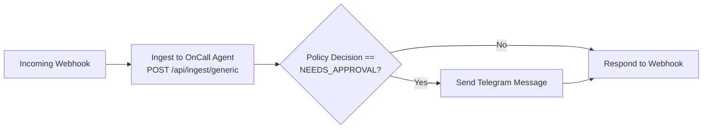

# n8n Integration: Automated Alert-to-Agent Workflow

This directory contains an importable workflow for [n8n](https://n8n.io) that connects external incident webhooks to the OnCall Agent's ingestion and human approval pipeline.

---

## Workflow Overview

1. **Webhook Trigger**: Receives incident payloads from external sources (monitoring systems, CI/CD pipelines, or custom webhooks).
2. **HTTP Request (`/api/ingest/generic`)**: Authenticates with `X-Webhook-Secret` and triggers incident normalization, root-cause diagnosis, and policy engine risk evaluation.
3. **IF Condition**: Checks if `policy.decision == "NEEDS_APPROVAL"`.
4. **Telegram Alert**: Sends a message to on-call engineers for high/medium risk actions.

---

## Import Steps

1. Open your n8n workspace in a browser.
2. In the left navigation, click **Workflows**.
3. In the top right corner, click the **...** (three dots) menu or **+ Add Workflow**, then select **Import from File**.
4. Select `alert-to-agent.json` from this directory (or copy/paste the JSON directly).
5. Configure environment variables or workflow credentials in n8n:
   - `WEBHOOK_SECRET`: Secret matching `WEBHOOK_SECRET` in OnCall Agent (defaults to `dev-secret`).
   - `TELEGRAM_CHAT_ID`: Your on-call Telegram chat ID.
   - Configure your Telegram Bot credential if using the native n8n Telegram node.
6. Click **Activate** to turn on the workflow.

---

## Outbound Hooks (Agent ➔ n8n)

The OnCall Agent also dispatches outbound events directly to n8n when `N8N_WEBHOOK_URL` is set:

- **Key Events**: `incident_opened`, `approval_needed`, `approved`, `applied`, `verified`, `rolled_back`.
- **HMAC Authentication**: Each request includes an HMAC-SHA256 signature in the headers:
  - `X-N8N-Signature: sha256=<hmac>`
  - `X-Signature-SHA256: <hmac>`
- The HMAC is calculated using `N8N_WEBHOOK_SECRET` (falling back to `WEBHOOK_SECRET`).
